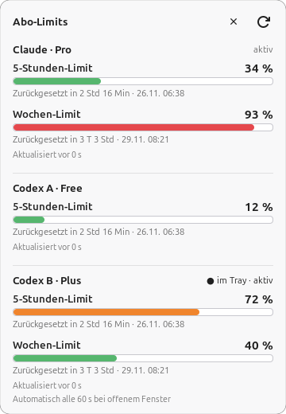

# Claude Limits Tray

A Linux tray app for checking your Claude and ChatGPT/Codex subscription limits. See how much of your 5-hour and weekly limits you’ve used and when they reset. The interface is in German.



> **Unofficial.** This project is independent of Anthropic and OpenAI. It uses the same undocumented usage endpoints as Claude Code and Codex. Those endpoints can change at any time.

## Features

- **Tray icon.** The letter identifies the subscription (`A` for Claude, `C` for Codex). The ring shows 5-hour usage, or the next longer limit if the 5-hour limit is unavailable. The highest usage across the subscription’s limits sets the color: green below 70%, orange from 70%, red from 90%.
- **Automatic subscription selection.** The icon reflects subscriptions used in the last 10 minutes. If several are active, it picks the one with the highest usage on its ring. If none are active, it shows the most recently used subscription.
- **Usage details.** Hover over the icon for limits and reset countdowns across subscriptions. Left-click for each plan and its status, with a progress bar, percentage, and reset time for each limit. Middle-click to refresh or right-click for the menu.
- **Multiple Codex profiles.** The app detects `~/.codex` and single-letter profiles such as `~/.codex-b` and `~/.codex-c`.
- **Background updates.** With the window closed, the app checks activity every 10 seconds and normally refreshes each subscription from its server every 5 minutes. HTTP 429 responses trigger a gradually longer pause.
- **Offline display.** Last known values appear dimmed when stale and are available immediately after restarting the tray.

## Requirements

- Linux with a panel that supports D-Bus StatusNotifierItems. Tested on Cinnamon with X11.
- Python 3.10 or later with GTK 3 bindings. On Debian, Ubuntu, or Linux Mint, install the system packages:

  ```bash
  sudo apt install python3-gi python3-gi-cairo gir1.2-gtk-3.0 python3-dbus python3-pil libglib2.0-bin
  ```

- At least one subscription login:
  - [Claude Code](https://docs.claude.com/en/docs/claude-code) signed in to a Claude subscription with `/login`.
  - [Codex CLI](https://github.com/openai/codex) signed in with a ChatGPT account. An API key alone is insufficient.

## Installation

```bash
git clone https://github.com/Bene77-w/claude-limits-tray.git
cd claude-limits-tray
./install.sh
```

The installer checks dependencies and creates the `~/.local/bin/usage-tray` symlink. Keep the cloned folder in place so the symlink works.

## Usage

```bash
usage-tray start   # Start in the background
usage-tray stop    # Stop the running instance
usage-tray status  # Check whether it is running (exit code 1 if stopped)
```

The startup log is at `~/.cache/claude-limits-tray/tray.log`. To launch the tray at login, add `usage-tray start` to your desktop’s startup applications.

Run these commands from the cloned folder:

```bash
./claude_limits_tray.py --print  # Print usage once in the terminal
./claude_limits_tray.py --demo   # Start with sample values and no network requests
```

Stop the tray before starting demo mode. A second invocation opens the window of the running instance.

To uninstall, run `./uninstall.sh` from the cloned folder. It stops the tray and removes the command and cache. You can then delete the cloned folder if you no longer need it.

## Privacy and security

| Source | Data used | Destination |
| --- | --- | --- |
| `~/.claude/.credentials.json` or `CLAUDE_CODE_OAUTH_TOKEN` | Claude Code OAuth access token. The file also provides the token expiry and subscription type. | `https://api.anthropic.com/api/oauth/usage` receives the access token. |
| Codex profile’s `auth.json` | `access_token` and `account_id` | `https://chatgpt.com/backend-api/wham/usage` receives both. |
| `~/.claude/projects/` and Codex profile `sessions/` directories | File modification times, Claude model names, and Codex usage-limit entries | Used locally. |

- The app holds tokens in memory and never logs, displays, or saves them. It uses only the Claude Code login from the Claude credentials file, excluding other credentials such as MCP server tokens.
- HTTP redirects are disabled. The app sends no telemetry and makes no requests to other servers.
- Claude Code and Codex manage their own token renewal. The tray checks for changes to their login files.
- The local cache at `~/.cache/claude-limits-tray/usage.json` contains profile keys, plan names, update timestamps, limit identifiers and labels, usage percentages, and reset times.

## Troubleshooting

| What you see | What to do |
| --- | --- |
| `Token abgelaufen` (token expired) | Start Claude Code or Codex again. The tray retries after the login file is updated. |
| HTTP 403 | The login lacks access to usage data. Sign in again in Claude Code or in the affected Codex profile. |
| HTTP 429 | The server is rate-limiting requests. The tray starts with a 3-minute backoff and doubles it on repeated responses. It also honors longer server retry intervals, up to 30 minutes. |
| Dim tray icon | The values are stale, for example because you’re offline or a request failed. Open the window for details. |
| No tray icon | Check `usage-tray status` and the startup log. If the app is running, check that your panel supports StatusNotifierItems. |

## Development

```bash
python3 -m unittest discover -s tests
```

| File | Role |
| --- | --- |
| `providers.py` | Fetches usage, detects activity, selects the active subscription, and manages the cache independently of GTK. |
| `claude_limits_tray.py` | Implements the D-Bus tray icon, menu, and GTK window. |
| `usage-tray` | Starts the app and uses its D-Bus name to stop it or check its status. |
| `install.sh` and `uninstall.sh` | Install and remove the launcher. |

The app implements StatusNotifierItem directly over D-Bus, so it requires no AppIndicator package. It re-registers the icon automatically when the panel restarts.

## License

[MIT](LICENSE)
